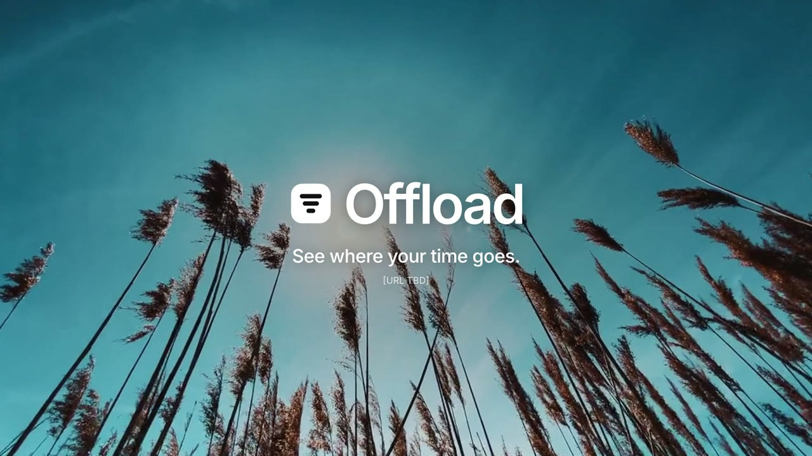
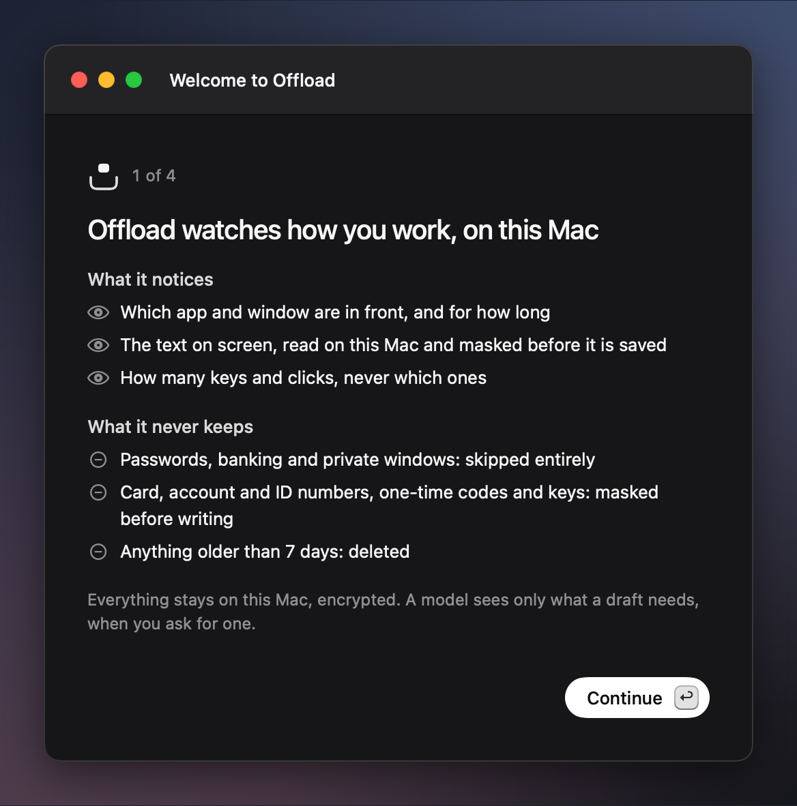
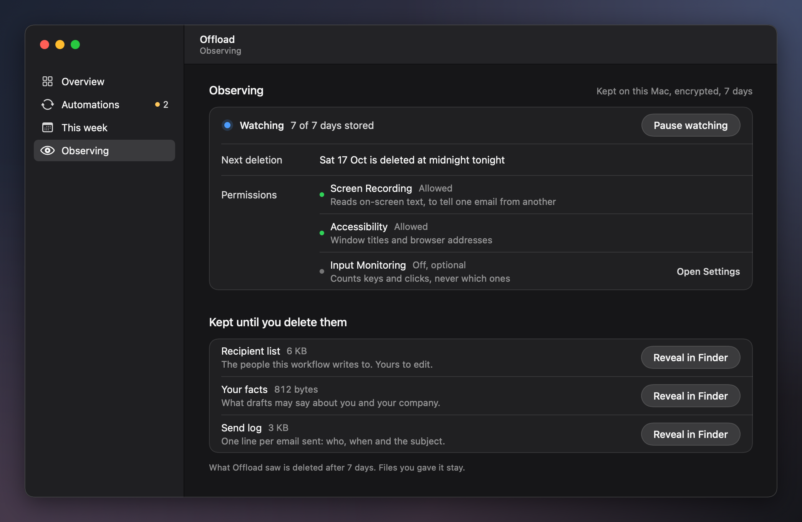
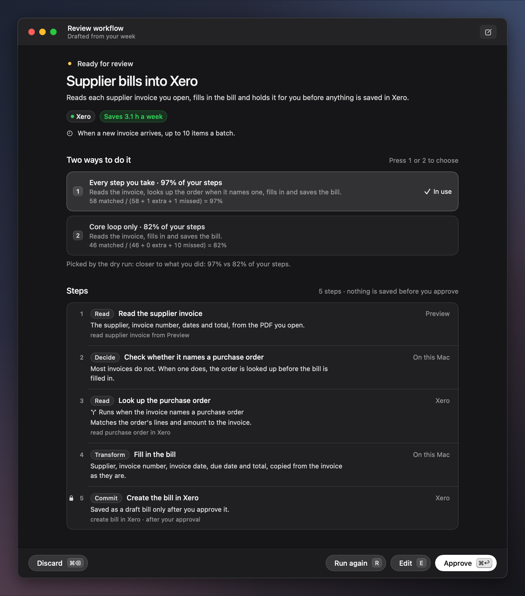
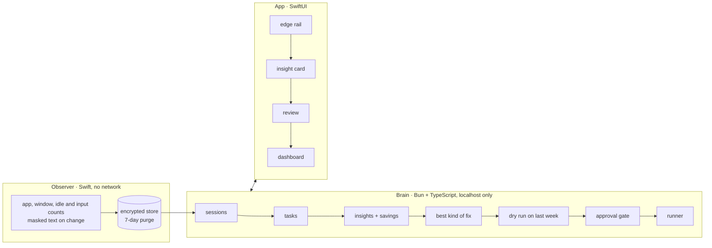

<div align="center">

# Offload

**See where your time goes. Fix what repeats.**

A Mac app that watches how you work, finds the work you repeat, and picks the best fix for each task.
Nothing runs without your approval.

[](docs/media/offload-launch.mp4)

▶ [Watch the launch video (30 s)](docs/media/offload-launch.mp4)

</div>

---

## Why

Most "AI automation" tools start from the tool and look for a job to do. Offload starts from your actual week.
It watches your screen privately on your Mac, groups what you do into tasks, measures the time each one takes,
and only then suggests a fix. The fix is not always a new workflow. Often it is a setup change, a small
tool, removing a step, or leaving the task alone.

## What it does

| | |
|---|---|
| **Shows where your time goes** | A week view of every task by app and activity, with the hours behind each number. |
| **Finds repeated work in any field** | Coding, calls, research, bookkeeping, recruiting, support. It is not tied to one role or app. |
| **Picks the best kind of fix** | A workflow (MCP, Composio or API), a custom tool, a setup change, removing the step, or leaving it alone. |
| **Shows its evidence** | Every figure links back to the moments on screen it was measured from. |
| **Asks before it acts** | Every fix runs as a dry run on last week first. Nothing runs without your one-time approval, and every change can be undone. |

## Real result

We ran Offload blind on 32 days of the founder's own screen activity (58.4 active hours a week):

| Where the time went | Hours a week | Share |
|---|---|---|
| Coding agents and AI chat | 27.2 h | 47% |
| Video, reels and shorts | 7.2 h | 12% |
| Calls | 5.6 h | 10% |
| Everything else | 18.4 h | 31% |

Realistic time saved: **about 5.6 hours a week (about 10%)**, mostly from changing how the coding agents
are set up. That is not a new automation. It is the kind of answer Offload is built to give.

## Privacy by design

- **Stays on your Mac.** The observer has no network code, and a test enforces it.
- **Encrypted and short-lived.** The local store is encrypted. Anything older than 7 days is deleted.
- **Masked before it is saved.** Card, account and ID numbers, one-time codes and keys are masked. Password,
  banking and private windows are skipped entirely.
- **Counts, never keys.** Offload records how many keys and clicks happen, never which ones.
- **Numbers come from code, not a model.** Every time and saving figure is computed deterministically. The model
  only names tasks and drafts fixes.

<table>
  <tr>
    <td></td>
    <td></td>
  </tr>
  <tr>
    <td align="center"><sub>What it notices, and what it never keeps</sub></td>
    <td align="center"><sub>Observer status, retention and permissions</sub></td>
  </tr>
  <tr>
    <td colspan="2"></td>
  </tr>
  <tr>
    <td colspan="2" align="center"><sub>A drafted fix, step by step, waiting for review. Screens show demo data.</sub></td>
  </tr>
</table>

## How it works

Three parts, all running on the Mac:



| Part | Stack | Role |
|---|---|---|
| `engine/` | Swift, Vision OCR, AES-GCM | Records activity into the encrypted local store. |
| `brain/` | Bun, TypeScript, Claude Agent SDK | Groups tasks, measures time, chooses fixes, dry-runs them and runs them after approval. |
| `app/` | SwiftUI + AppKit | The edge rail, insight cards, review window and dashboard. |
| `web/` | React 19, Vite | Admin web for teams (in progress). |

Fixes run through the Claude Agent SDK. Integrations resolve in order: MCP, then Composio, then a direct API,
then computer use.

## Run it

Requirements: macOS 14 or later, Apple Command Line Tools, [Bun](https://bun.sh) 1.3.12.

```bash
scripts/demo.sh        # build everything and open the app on a demo week
scripts/run.sh         # run on your real activity
scripts/verify-all.sh  # run every test suite
```

Full setup, including the Anthropic key and optional local models: [docs/SETUP.md](docs/SETUP.md).

## Status

Working prototype, built for a hackathon. The name "Offload" is a working name.

## License

Copyright © 2026 Muhammad Ali. All rights reserved. This code is public for hackathon review only.
See [LICENSE](LICENSE).
