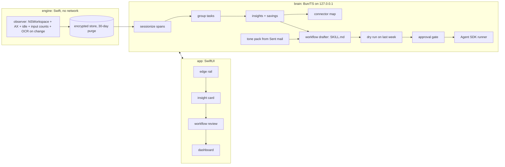

# Plan: Offload

Status: drafted 2026-10-24. Sources: `adam/memory/research/10..14`. Terms: `plan/CONTEXT.md`.

## Approach
Three parts, all on the Mac:

1. **Observer** (Swift, `engine/`): records Events into an encrypted local store. No network code.
   Reuses Workpaper's capture types, Vision OCR, perceptual hash, exclusion policy and AES-GCM store.
   New: focus Spans, idle detection, per-minute input COUNTS (never key values), 30-day purge (ADR 0016; was 7).
2. **Brain** (Bun + TypeScript, `brain/`): reads the store, sessionizes, groups Tasks, ranks Insights,
   estimates Savings, maps Connectors, builds Tone packs, drafts Workflows, dry-runs and runs them
   through the Claude Agent SDK. Deterministic code for all numbers; the model only names, scores
   judgement/risk, and writes drafts. Every number links back to event ids.
3. **App** (SwiftUI + AppKit, `app/`): the Rail, Cards, Workflow review, and Dashboard. Talks to the
   Brain on 127.0.0.1 with a per-launch token.

## Decisions (ADRs in plan/adr)
- 0001 New repo; copy Workpaper code, no git link. Finance Q&A, Deal Vault and audit UI are dropped.
- 0002 Build with plain swiftc (SwiftPM link is broken on this machine, Workpaper ADR 0007). No Xcode needed.
- 0003 Metadata-first privacy (cua Computer History charter): store app/title/URL/counts; OCR text only on
  change, masked with Workpaper detectors, kept 30 days (ADR 0016). Never store key values. Fail closed on privacy.
- 0004 Execution layer = Claude Agent SDK + SKILL.md workflows. Gmail MCP first, Composio for long tail. No n8n (licence).
- 0005 Numbers are deterministic. The model never produces a time or a saving figure.
- 0006 Every external action passes an approval gate until the user turns on auto-run per workflow.
- 0007 Perception for any domain; connectors resolve by a chain per app (MCP -> Composio -> API -> computer use).
- 0008 `@anthropic-ai/sdk` (pinned, already the Agent SDK's peer) for computer use with `computer_toolset_20260801`.
- 0013 (proposed) Safe builder: run builder code in a micro-VM; ship config-patch setup fixes without the builder first.
- 0015 Read steps: read arguments learned from the recordings; Offload builds its own view (no stored page address); read only; done rows before limits.

## Slices
| id | name | owner type | depends |
|---|---|---|---|
| s01 | scaffold: engine/brain/app layout, build scripts, verify-all | engineer | – |
| s02 | observer: events, spans, idle, counts, OCR-on-change, encrypted store, 7-day purge (30 days since s32, ADR 0016) | engineer (Swift) | s01 |
| s03 | brain core: read store, sessionize, task grouping, stats, evidence links | engineer (TS) | s01 |
| s04 | insights: ranking, saving estimator, connector map | engineer (TS) | s03 |
| s05 | tone pack + workflow drafter + dry run + approval gate + runner | engineer (TS, Agent SDK) | s04 |
| s06 | design system: tokens, materials, type, motion, components | UI | s01 |
| s07 | rail + insight card + keyboard flow | UI | s06, s04 API |
| s08 | workflow review + dashboard + 7-day timeline | UI | s06, s05 API |
| s09 | demo seed: 7 synthetic days incl. 100 outreach emails/day, end to end | engineer | s02..s05 |
| s10 | e2e, design review with screenshots, reality check | QA + UI | all |
| s11 | perception: masked keyframes, local vision Captioner (Ollama), Frame notes in store (ADR 0007) | engineer (Swift + TS) | s02 |
| s12 | understanding: span descriptions, local embeddings, any-domain task induction, multi-domain fixtures | engineer (TS) | s11 |
| s13 | connector chain: MCP -> Composio -> API -> computer use, health checks, auto-fallback | engineer (TS) | s10e |
| s14 | general workflow builder: any task profile -> SKILL.md + steps + gates; onboarding role/industry context | engineer (TS) + UI | s12, s13 |
| s15 | e2e any-domain + independent design review 4 | QA + UI | all |
| s26 | individual automation e2e: one non-email task from capture to an executed, approved fix and a measured saving; live batches for general plans; ADR 0013 | engineer (TS) | s13, s14, s22, s23, s24 |
| s27 | workflows fetch their own data: the read source learned from the recordings, a read-only read step through the chain (gate mode read), live items from the fetched values, items.csv only as the fallback; honest reading time | engineer (TS) | s13, s14, s17, s26 |

## API (brain, 127.0.0.1, bearer token)
- `GET /status` observer state, days stored, next purge.
- `GET /insights` ranked Insights with arithmetic and evidence ids.
- `GET /insights/:id/evidence` the spans behind a figure.
- `POST /workflows/draft {insightId}` → Workflow draft (SKILL.md, connectors, gates).
- `POST /workflows/:id/dry-run` → per-instance output next to what the user did.
- `POST /workflows/:id/approve` / `pause` / `delete`.
- `GET /dashboard` automations, status, hours saved (estimated vs measured).
- `GET /timeline?day=` spans per day for the timeline.
