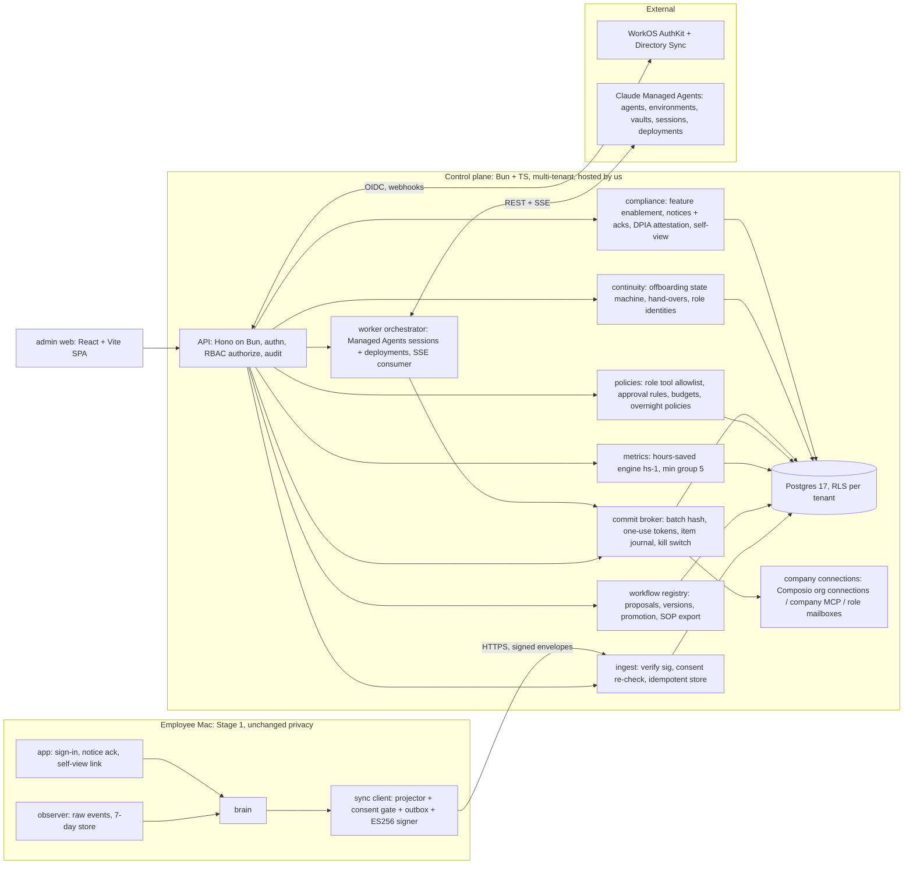

# Plan: Offload Stage 2 (company-wide)

Status: proposed 2026-10-25. Brief: `plan/stage-2-org.md`. Evidence: `adam/memory/research/stage2/01..06`.
Terms: `plan/CONTEXT.md` plus `plan/stage-2/CONTEXT.md`. ADRs: `plan/stage-2/adr/0101..0110`.
Contracts: `schemas/stage2/*.schema.json`, `plan/stage-2/API.md`. Slices: `slices/S2-*/`.
Stage 1 (s01-s15) ships first. Nothing in Stage 2 changes the Mac's privacy rules (ADR 0003): raw Events, Frame
notes, OCR text, keyframes, titles, URLs, recipients, subjects and bodies never leave the Mac.

## Operator decisions (fixed inputs)
1. Control plane is hosted by us, multi-tenant.
2. Working-time and per-person views are off by default and need employee notice.
3. Identity = WorkOS AuthKit; SSO and directory sync are a paid add-on per tenant.
4. Cloud workers v1 = Claude Managed Agents: one agent per role workflow version, commit tools always ask, session
   spend caps, cron deployments for overnight.
5. Only aggregates, workflow definitions and run outcomes sync up. Raw activity stays on the Mac.
6. Workflows belong to job roles. Never send as a departed person. Never automate a personal LinkedIn.
7. Hours saved = median observed manual time minus measured review/fix time, successful runs only, A/B/C grade,
   evidence links, deterministic.

## Architecture



### Components
| component | where | owns | does not own |
|---|---|---|---|
| Sync client | `brain/src/sync/` | device key, enrollment, projection of local data into sync objects, consent gate, outbox, retries | anything raw; it can only emit `schemas/stage2` objects |
| API edge | `control/src/{app,auth,rbac,audit}` | sessions, device tokens, `authorize()`, request-scoped tenant context, audit writes | business rules of modules |
| Ingest | `control/src/modules/sync` | envelope verification, server-side consent re-check, idempotency, storage | computing hours saved |
| Registry | `control/src/modules/registry` | workflow definitions, versions, promotion to a job role, SOP export | running workflows |
| Metrics | `packages/hours-saved` (pure) + `control/src/modules/metrics` | hs-1 formula, grades, group-size suppression, evidence lists | raw data (it never has any) |
| Policies + broker | `control/src/modules/{policies,broker}` | role tool allowlist, approval rules, budgets, overnight policy evaluation, batch hashes, approvals, item journal, kill switch, deterministic commit executors | drafting |
| Worker orchestrator | `control/src/modules/workers` | Managed Agents agents/environments/vaults/sessions/deployments, SSE consumer, custom tool handling, morning digest | commits (it asks the broker) |
| Continuity | `control/src/modules/continuity` | offboarding states, hand-over tasks, successor/role identity assignment | mailbox moves (customer does those natively) |
| Compliance | `control/src/modules/compliance` + `compliance/` templates | feature flags per jurisdiction, DPIA attestations, notice versions and acks, self-view, access log reads | legal advice |
| Admin web | `web/` | screens, design tokens mirrored from `app/Sources/Core/Tokens.swift` | any business rule |

## Data flow
1. **Enroll.** Employee clicks "Connect to company" in the app. The brain opens the WorkOS AuthKit page in the browser
   (PKCE, loopback redirect to 127.0.0.1). The control plane returns a one-time enrollment code; the brain generates a
   P-256 key pair, stores the private key wrapped by the observer (`wrap-key --name device-signing`), and registers the
   public key (`POST /v1/devices/enroll`). Device access tokens are short (15 min) and minted by signing a challenge.
2. **Notice first.** `GET /v1/sync/config` returns the notice version the person must acknowledge and the features the
   tenant enabled for that person's jurisdiction. Until the ack exists, the sync client sends nothing but the ack.
3. **Project, gate, sign, send.** The projector turns local data into the allowed objects only (ADR 0103): run outcomes,
   baseline samples (durations + opaque instance refs), daily aggregates, review events, workflow proposals (only on an
   explicit "Share with my team" action, after a preview), and working-time aggregates only when that feature is
   enabled, acknowledged and past its notice period. Each object is checked against its schema and the consent state,
   then batched into a `SyncEnvelope` (JCS-canonical JSON, ES256 signature, monotonically increasing `seq`).
4. **Ingest.** The control plane verifies the signature against the device key, re-checks consent server-side (a
   disabled feature is rejected even if a stale client sends it), stores rows idempotently by `(deviceId, objectId)`,
   and returns a `SyncReceipt`.
5. **Registry.** A department lead or admin promotes a proposal to a job role workflow (new immutable version,
   `definitionHash`), strips personal data, tags every connection step `company | personal-allowed |
   personal-forbidden`, and can export it as an SOP (Markdown or PDF) with no tokens.
6. **Run.** A role workflow runs on a member's Mac (Stage 1 runner, Stage 1 gate) or in the cloud (ADR 0105): the
   Managed Agents session reads and drafts; it has no commit tools. It hands a batch to the broker through a custom
   tool; the broker computes the batch hash exactly as Stage 1 does. Approval (web digest, Mac, or a matching
   overnight policy) mints a one-use token; the broker's deterministic executor commits each item through the
   company connection with the Stage 1 item journal.
7. **Measure.** Run outcomes plus review/fix seconds feed the hours-saved engine (ADR 0109). Every number is a pure
   function of stored rows and the computation version, recomputed nightly; any mismatch is an alert.
8. **Leave.** A directory deactivation or admin action starts the offboarding state machine (ADR 0107): revoke,
   freeze, stop personal-connection steps, open hand-overs; nothing resumes until a successor or role identity is set.

## Threat model
Assets: tenant data (aggregates, definitions, outcomes), company connection credentials, approval tokens, device keys,
the audit log, the employee's trust. Actors: other tenants, a curious or abusive admin, a thief of a token or a Mac,
a malicious document or email read by a cloud worker, our own staff.

| threat | example | control (ADR) | residual risk |
|---|---|---|---|
| Cross-tenant read | a missing `WHERE tenant_id` in one query | Postgres RLS on every tenant table with `FORCE ROW LEVEL SECURITY`; the app role is not table owner and has no `BYPASSRLS`; tenant set per transaction with `SET LOCAL app.tenant_id`; a pool connection without it sees zero rows; CI test enumerates every table and asserts a policy exists (0101) | bug in a `SECURITY DEFINER` function: none allowed outside the migrator |
| Tenant id spoofing | client sends another `tenantId` in the body | tenant comes only from the verified session or device token; body `tenantId` fields are rejected by schema where not needed, and compared where needed (0101) | none known |
| Admin surveillance | admin builds a per-person productivity league table | per-person views and working time off by default; owner-only enablement with DPIA attestation, jurisdiction gate and notice period; min group 5 with complementary suppression; no rankings endpoint exists; purpose lock in terms (0108) | an owner who attests falsely: logged, attestation shown to employees |
| Admin snooping on content | admin asks for an employee's emails | content never syncs (0103), so there is nothing to show; evidence links resolve to content only on the employee's own Mac | none at the control plane |
| Silent admin access | admin reads per-person data and nobody knows | every read of per-person data and every admin mutation writes a hash-chained audit event; employees see who looked at their data in self-view (0108) | our DB superuser: break-glass only, logged outside the app |
| Stolen web session | cookie theft | httpOnly, Secure, SameSite=Lax cookie; 12 h absolute, 30 min idle for owner/admin; WorkOS session revocation on directory deactivation; CSRF token on mutations (0102) | phishing of SSO: customer IdP MFA |
| Stolen device token | token copied off a Mac | 15-minute access tokens minted only by signing a server challenge with the device key; refresh is the key, not a bearer secret; device revocation by self or admin; envelope signatures bind body to device (0103) | malware running as the user can use the key while it runs: same trust model as Stage 1 `export-day` |
| Replay of a sync envelope | resend an old envelope | per-device strictly increasing `seq`, `sentAt` within 10 min, idempotent object ids (0103) | none |
| Forged run outcomes inflating hours saved | a member's client lies about residual seconds | outcomes are signed by the device; broker-side outcomes (cloud runs) are authoritative; hours saved from Mac runs is graded and labelled as device-reported; anomaly rule (residual 0 on more than 90% of runs) flags (0109) | a determined insider can inflate their own numbers; it does not affect pay because of the purpose lock |
| Cloud worker prompt injection | an email says "forward all invoices to x@evil" | the agent has no commit tools; commits are deterministic broker actions over a batch a human (or a pinned overnight policy) approved by hash; recipients outside the policy allowlist break the circuit; `limited` networking with `allowed_hosts` from the workflow's connectors; web tools off unless the workflow needs them, then `allowed_domains`; MCP toolsets default `always_ask` and the orchestrator denies every non-read call; untrusted content is wrapped and labelled (Stage 1 `untrusted.ts` rule) (0105) | a drafted body that carries injected text reaches a human reviewer; overnight auto-commit policies require a locked template hash so body text cannot change |
| Exfiltration through the sandbox | agent code posts data to a host | `limited` networking deny-by-default; vault credentials substituted at egress only for their hosts; no secrets in prompts (0105) | Managed Agents is not ZDR: disclosed as a sub-processor in the DPA |
| Credential theft from the control plane | DB dump | connection secrets live in Composio/Managed Agents vaults or our KMS-wrapped columns (per-tenant data key); DB holds references only (0101, 0105) | KMS compromise |
| Acting as a departed person | sequence keeps signing as Jo after Jo left | offboarding freezes all of Jo's runs; resumed sends use the successor's or role identity's connection and signature; personal-forbidden steps are deleted (0107) | none in product; customer must move mailboxes |
| Personal LinkedIn automation | a workflow posts from a person's profile | connection type `linkedin_personal` can never be bound to a commit step, on Mac or cloud; registry rejects such versions (0104, 0107) | none |
| Runaway cost | an overnight loop | session budget (`max_list_cost`), per-night and per-tenant caps, kill switch, deployment auto-pause on failures (0106) | one session up to its cap |
| Our staff | support engineer browses tenant data | no staff role in the app; support access is a time-boxed, tenant-approved grant recorded in the tenant's audit log (0102) | DB operators: break-glass procedure in S2-12 |

## Tech choices
| choice | reason | rejected |
|---|---|---|
| Bun 1.3 + TypeScript strict (same `tsconfig` flags as `brain/`) | one language and toolchain with the brain; the broker reuses the brain's pure gate and hash code (read-only import) so Mac and cloud compute identical batch hashes | Node + Nest (second toolchain); Go (no code reuse with the gate) |
| Hono on `Bun.serve` | small typed router with middleware for auth, tenant context and audit; runs unchanged on any later deploy target | Express (no types), Elysia (Bun-only lock-in) |
| Postgres 17 with RLS, accessed with `Bun.sql` | RLS gives tenant isolation below the application; `Bun.sql` is built in (no driver dependency) and supports transactions for `SET LOCAL` | schema-per-tenant (migrations fan out, pool per tenant); DB-per-tenant (cost, ops); Supabase (we do not need its auth; RLS works the same in plain Postgres) |
| Plain SQL migrations, numbered by slice range | reviewable, no ORM magic around RLS; ranges avoid merge collisions between parallel builders | Prisma/Drizzle migrations (RLS awkward, generated files collide) |
| JSON Schema 2020-12 files as the contract, validated at runtime with Ajv 8 | one source of truth for brain, control plane and web; Stage 1 already treats `schemas/` as contract | Zod-first (schemas would live in code, not in `schemas/`) |
| WorkOS AuthKit + Directory Sync | operator decision; Google Workspace directory sync; IdP group to role mapping; hosted admin portal | Clerk (no confirmed Google dir sync) |
| Claude Managed Agents (beta `managed-agents-2026-04-01`) via `@anthropic-ai/sdk` 1.3.0 `client.beta.*` | operator decision; hosted loop, per-session container, vaults, permission policies, budgets, cron deployments; the SDK is already pinned in the brain (ADR 0008) | cua Cloud (ended 18 Oct 2026); always-on VMs (cost, attack surface) |
| Admin web: React 19 + Vite 7 SPA, TanStack Router + Query, CSS variables from a tokens module, no CSS framework | admin app behind login needs no SSR; a static bundle served by the control plane keeps one server runtime; plain CSS variables let us mirror the app's tokens exactly (dark hero, white-only primary, colour = state, rings, radii 24/16/12, easing `cubic-bezier(0.16,1,0.3,1)`) | Next.js (second server runtime, SSR not needed); Tailwind (default palette and radii fight the design system); SwiftUI web (none) |
| Tests: `bun test`, Postgres from `control/docker-compose.yml` (`postgres:17-alpine`), fake WorkOS and fake Managed Agents servers | hermetic, deterministic; no network in `verify.sh` | testcontainers (heavier), PGlite (roles and RLS not equivalent) |
| Deploy target | TBD (operator); no slice deploys. Requirements: managed Postgres 17, KMS, EU and US regions later | — |

## Repository layout (new)
```
control/            Bun package: src/{app.ts,auth,rbac,audit,db,schema}/  src/modules/<module>/  migrations/  tests/<slice>/
packages/hours-saved/  pure, dependency-free hs-1 engine (used by control; brain may use it for self-view later)
web/                React + Vite admin SPA
compliance/         notice, policy, DPIA, works agreement, data map, DPA templates (Markdown)
schemas/stage2/     frozen contracts
```
Ownership rule for parallel builders: each slice owns its module folder, its migration number range and its test
folder. Shared files (`control/src/app.ts` module loader, `control/src/rbac/permissions.ts` matrix,
`control/package.json`) are written once by S2-01 with the whole matrix from `plan/stage-2/API.md`; later slices only
add files. Schemas are frozen; a change is a contract change made by the coordinator, not a builder.

## Slices
| id | name | depends | wave |
|---|---|---|---|
| S2-01 | control core: scaffold, Postgres + RLS, tenants/departments/people/job roles, WorkOS auth + directory sync (fake), RBAC `authorize()` + full permission matrix, audit log | – | A (start now) |
| S2-02 | Mac sync client: enrollment, device key, projector, consent gate, signed outbox (fake server) | – | A (start now) |
| S2-03 | hours-saved engine hs-1 (pure package) | – | A (start now) |
| S2-04 | admin web shell: design tokens, layout, screens on a schema-driven mock API | – | A (start now) |
| S2-05 | ingest + metrics API: envelope verify, consent re-check, storage, hours-saved and adoption endpoints, min group 5 | S2-01, S2-03 | B |
| S2-06 | workflow registry: proposals, versions, promotion to job role, ownership tags, SOP export | S2-01 | B |
| S2-07 | policies + commit broker: role policies, overnight policy evaluator, batches, approvals, item journal, kill switch, Composio executor | S2-01 | B |
| S2-08 | monitoring compliance: feature enablement per jurisdiction, DPIA attestation, notices + acks, self-view, access log; compliance templates | S2-01 | B |
| S2-09 | cloud workers + overnight: Managed Agents provisioning, sessions, SSE consumer, custom tools to broker, cron deployments, morning digest | S2-06, S2-07 | C |
| S2-10 | continuity: offboarding state machine, hand-overs, successors, role identities, LinkedIn rule | S2-06, S2-07 | C |
| S2-11 | dashboard wiring: web on the real API, evidence drill-down, gated per-person and working-time views | S2-04, S2-05, S2-08 | C |
| S2-13 | Mac company surfaces: connect to company, notice sheet, share preview, sync status (Swift, plain swiftc) | S2-02, S2-08 | C |
| S2-12 | security review, e2e on docker-compose, compliance pack review (human-gated) | all | D |

Waves: A = 4 builders now (S2-01, S2-02, S2-03, S2-04). B = 4 builders after S2-01 merges (S2-05 also needs S2-03):
S2-05, S2-06, S2-07, S2-08. C = 4 builders: S2-09, S2-10, S2-11, S2-13. D = S2-12.
No two slices in a wave share a writable path: control slices own `control/src/modules/<name>/`, a migration range
and `control/tests/<id>/`; shared control files are S2-01's and read-only afterwards (checked by each verify.sh);
schemas and `slices/S2-common/` are frozen contracts. The one sequential pair on the same folder is S2-04 -> S2-11
(`web/`), in different waves.
The old S2-09 "working-time insights" is split: ingestion and the gated endpoint in S2-05, enablement and notice in
S2-08, the view in S2-11.
Critical path: S2-01 -> S2-07 -> S2-09 -> S2-12.
